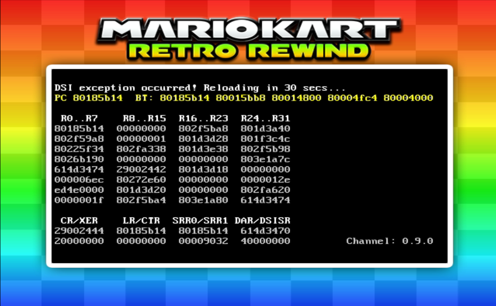

# Retro Rewind Launcher - DEBUG BUILD

> **This is a debug build, not a stable release.** \
> It is meant for developers and testers who need to find out why the launcher fails on a specific console, SD card or network. \
> Please do not distribute it as the normal channel and do not use it for everyday play.

The debug build is the regular launcher with extra logging and extra error output built in. The launcher itself behaves the same, except for the points below.

### What is different from the release build

- It writes a detailed log to `sd:/RR_debug.log` on every start (see below). Logging is always on; there is no switch.
- It is a little slower and writes more to the SD card: warnings and errors are flushed to the card immediately.
- The screen shows a `DEBUG W:x E:y` counter with the number of warnings and errors so far.
- Fatal errors show the place in the source code, a short diagnosis and the latest warnings, and stay on screen for 60 seconds.
- The crash screen shows a backtrace.
- The text area is larger (62x18 characters).

### Building the debug build

Build it with `./build.sh` instead of `make` (arguments such as `clean` are passed on). The script only adds a linker flag that is needed with libogc 3.x. See [DEBUG-BUILD.md](./DEBUG-BUILD.md) for all details and for the list of changed files. The general requirements (DevkitPro, libcurl) are listed under *Building* in the description of the regular launcher below.

### Privacy note

The log contains the file listing of your SD card, the console clock and the full text of HTTP requests and answers. Look through it before posting it publicly.

### The log file

The launcher creates `sd:/RR_debug.log` on every start. Every line looks like this:

```
[   1.012] E versionsfile.c:306 rrc_versionsfile_get_necessary_urls_and_versions | versions file line 1 ("<html>...") has 1 part(s) ...
 seconds   L file:line         function                                          | message
```

`L` is the level: `D` debug, `I` info, `W` warning, `E` error, `F` fatal. The log contains the system and SD card layout, every file access that fails, every HTTP request (including the server's headers) and the content of the versions file. When a file operation fails, the log also contains a diagnosis (does the file exist, free space, a raw read of the SD card, memory state).

The file always ends with a **SUMMARY** block that lists all warnings and errors. If the program did not exit normally, the block says so. Start reading there.

### Reading a crash

If the launcher crashes, the exception screen shows the registers and a short backtrace. The SD card cannot be written inside an exception handler, so take a photo of the screen. The log file ends with the last line written before the crash.

To turn the backtrace into function names and source lines, use the `.elf` file from the same build. A backtrace lists return addresses, so subtract 4 from each address to get the call itself:

```
powerpc-eabi-addr2line -f -C -e RR-Launcher-https.elf 80015ae4 8001472c 80004fc0
```

### Example: an HTML page instead of the versions file

A parental-control filter on a user's router answered the update request with an HTML page instead of the versions file. The launcher accepted the page as the versions file and crashed. The following was reproduced in Dolphin with a local server that returns an HTML page for the update URL (with Dolphin's "Enable MMU" option on).



The log shows that an HTML page (`Content-Type: text/html`) was received and parsed as the versions file:

```
[ 0.995] curl < HTTP/1.0 200 OK
[ 0.995] curl < Content-Type: text/html
[ 1.007] HTTP 200 from https://update.rwfc.net/RetroRewind/RetroRewindVersion.txt - 15205 bytes received
[ 1.008] versions>   1: <html><head><title>Blocked</title></head><body>
[ 1.012] versions file split into 302 lines (res 0)
[ 1.012] E versions file line 1 ("<html><head><title>Blocked</title></head><body>") has 1 part(s) - no URL; parts[1] is uninitialised memory
```

Resolving the backtrace shows where it happens:

```
_free_r
rrc_versionsfile_get_necessary_urls_and_versions  source/update/versionsfile.c:330
rrc_update_do_updates                             source/update/update.c:679
main                                              source/main.c:304
```

A line without a space has only one part, so `parts[1]` is never set, but the code frees it. What happens depends on what was in that memory before: on the exception screen above, `DAR` is `614d3470` and `R4` is `614d3474`, the freed pointer and the address of its block header. Emulators hand out zeroed memory, so the bug often stays hidden there.


---

Everything below is the description of the regular launcher.


This is an experimental channel for Wii, Wii U and Dolphin to launch and manage the Retro Rewind Mario Kart Wii distribution. \
The channel aims to provide three main features:

- Stable and performant patching and loading of Retro Rewind.
- Functionality to update Retro Rewind, and (optionally) automatically check for updates.
- Provide basic configuration including language and "My Stuff" (for custom assets).

The channel makes use of a simple text-based interface enclosed in a decorative banner.
This is a stylistic choice intended to keep the dependency stack lightweight and the launcher itself performant.
This style is heavily influenced by existing similar designs such as [YAWM ModWii Edition](https://github.com/modmii/YAWM-ModMii-Edition).

### Motivation

This channel is set to replace the existing Riivolution-based launcher. It solves a number of issues with that launcher:

- It is very overengineered and contains many unused features,
- It takes a long time to initially load,
- It is difficult and time consuming to maintain,
- It has a tendency to randomly hardlock and/or crash,
- It doesn't work with Dolphin.

In addition, a new channel would allow us to add novel features such as a quick launch to skip menus and get right into playing.

### Technical Details

This channel is intended to be a drop-in replacement launcher for the exiting Riivolution-based channel (as well as Riivolution itself). This is achieved by providing custom DVD patches (as well as code patches) which are sourced with the provided XML patch document which ships with the distribution itself. When launching, the DVD routines are patched to redirect some file reads from the DVD to the SD card. This allows custom content to be loaded (and for simple extensibility, merely by adding to the XML document).

The channel is designed to be simple, but its code does contain some novel features designed to improve stability, reliability, and to make it easier to maintain and extend. A lot of the code is commented, especially subsystems; see `source/result.c` as an example.

### Building

In order to build this project, you need:

- [DevkitPro](https://devkitpro.org/wiki/Getting_Started), specifically all packages in the `wii-dev`, `ppc-dev` and `ppc-mxml` groups.
- Additional libraries: libcurl (the `install-libs.sh` script can install them for you)

This project uses a `Makefile` for building the project: running `make` in the root directory will build the project and produce a `RR-Launcher.dol` file (the main DOL that starts the channel),
as well as `runtime-ext/runtime-ext-*.dol` files, where \* is all supported region codes. This file is loaded before the game and contains patched DVD functions to load RR code from the SD card.

### Contributing

If you would like to see any features added or have any questions or problems, feel free to open an issue on the upstream respository. \
If you would like to contribute, first refer to `Building` above. Once you are able to successfully build and run the channel dol, you can begin contributing. A good place to start is to check out any outstanding issues. All contributions are thoroughly welcome!

Please note that the channel is still largely incomplete and as such is quite fast moving. There may be major changes as the channel matures. Once it is stable, novel contribution will become easier.

### License

This project is licenced via the GPLv3. Use of any material sourced from this project must be licensed similarly or using any later revision of the GPL. Refer to LICENSE, or go to https://www.gnu.org/licenses/, for more information.
